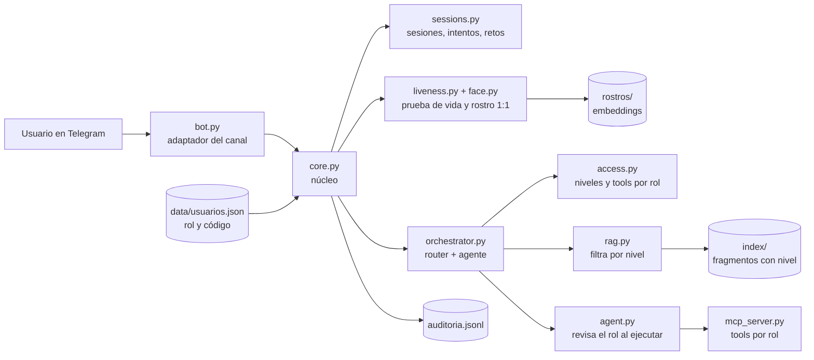

# Examen final: Asistente del Curso en Telegram con acceso por reconocimiento facial

Versión 5 del Asistente del Curso de IA. El asistente del Lab 04 se pasó a Telegram y se le agregó identidad y
control de acceso: cualquier persona puede hacer preguntas públicas, pero la información restringida de los
documentos (RAG) y del sistema académico (MCP) solo se entrega después de iniciar sesión con el rostro y una
prueba de vida, y siempre según el rol.

La idea central es que el LLM no decide quién puede ver qué. Lo decide el código: el filtro de documentos se hace
antes de que el modelo vea los fragmentos, las tools que recibe el modelo dependen del rol y se vuelven a revisar
al ejecutarlas, y el código del estudiante lo pone el software desde la sesión.

## Cómo está organizado



| Archivo | Qué hace |
|---|---|
| `bot.py` | Adaptador de Telegram: comandos, mensajes, video-nota del login y botones de confirmación |
| `core.py` | Núcleo sin Telegram: responder, iniciar sesión, cerrar sesión y auditar |
| `access.py` | Sesión, niveles de documentos y tools de cada rol; pone el código del estudiante desde la sesión |
| `sessions.py` | Sesiones con vencimiento, intentos fallidos con bloqueo y retos aleatorios de un solo uso |
| `face.py` | Detección (YuNet) y embeddings (SFace) de rostros con OpenCV |
| `liveness.py` | Revisa la video-nota: un solo rostro, el giro pedido y el rostro frontal contra el enrolado |
| `enroll.py` | Enrolamiento local con 3 a 5 fotos; guarda solo los embeddings en `rostros/` |
| `umbral.py` | Tabla FAR/FRR para elegir el umbral del rostro |
| `audit.py` | Log de auditoría en JSONL, sin imágenes ni embeddings |
| `users.py` | Lee `data/usuarios.json`, la única fuente del rol y del código |
| `pruebas_seguridad.py` | Suite de ataques sobre el núcleo, sin Telegram |
| `documents.py`, `vector_store.py`, `rag.py` | RAG del Lab 02 con nivel de acceso por fragmento y filtro antes del top-k |
| `mcp_server.py`, `mcp_client.py` | Servidor y cliente MCP con las tools del examen |
| `orchestrator.py`, `agent.py`, `router.py`, `prompts.py` | Orquestador del Lab 04 adaptado a la sesión |

## Cómo ejecutarlo

Desde la raíz del repositorio, con el `.env` configurado (ver `.env.example`):

```powershell
uv sync
uv run python labs/05-examen-final/ingest.py
uv run python labs/05-examen-final/pruebas_seguridad.py
uv run python labs/05-examen-final/enroll.py integrante_1 <telegram_user_id> foto1.jpg foto2.jpg foto3.jpg
uv run python labs/05-examen-final/umbral.py labs/05-examen-final/rostros/fotos_umbral
uv run python labs/05-examen-final/bot.py
```

Los modelos de rostro se descargan del repositorio `opencv/opencv_zoo` y van en `modelos/`. Las carpetas
`modelos/`, `rostros/`, `index/` y el archivo `auditoria.jsonl` no se suben al repositorio.
